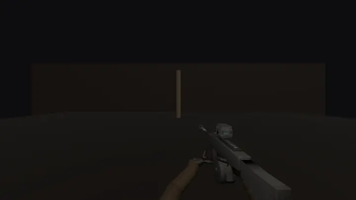

# APOCALISSE-12

The Apocalisse is an automatic shotgun with a drum: a steady stream of pellets, slower than the other automatic weapons, and a wide spread.

## Numbers

| Grade | Class | Damage | Fire | Magazine | Sight |
| --- | --- | --- | --- | --- | --- |
| [IV](../grades/grade-4.md) | automatic drum shotgun | 8 x 11 | auto, 300 rpm | 20 | holographic |

Here 8 x 11 means eight pellets of 11 damage each.

## Standard and desert

The same weapon in both modes. In the desert it is in the armoury at twice the standard price. See [the desert](../modes/desert.md).

## Related

- [Weapon grades](../grades/grade-4.md): the grade it belongs to.
- [BREACHER-12](breacher-12.md): the pump shotgun of grade II.
- [MARTELLO-12](martello-12.md): the semi-automatic shotgun of grade III.
