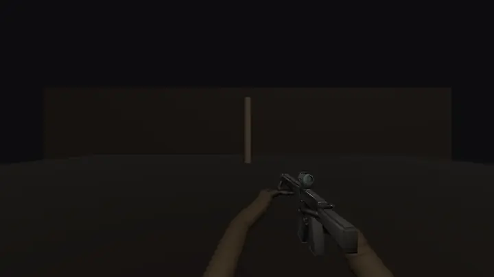

# AR-9 MALLEUS

The Malleus is the standard assault rifle of grade II: steady automatic fire, with a red dot for quick aim.

## Numbers

| Grade | Class | Damage | Fire | Magazine | Sight |
| --- | --- | --- | --- | --- | --- |
| [II](../grades/grade-2.md) | assault rifle | 30 | auto or semi, 700 rpm | 30 | red dot |

## Standard and desert

The same weapon in both modes. In the desert it is in the armoury at twice the standard price. See [the desert](../modes/desert.md).

## Related

- [Weapon grades](../grades/grade-2.md): the grade it belongs to.
- [ARCANGELO-47](arcangelo-47.md): the assault rifle of grade III.
- [TRINITA'](trinita.md): the burst rifle of the same grade.
