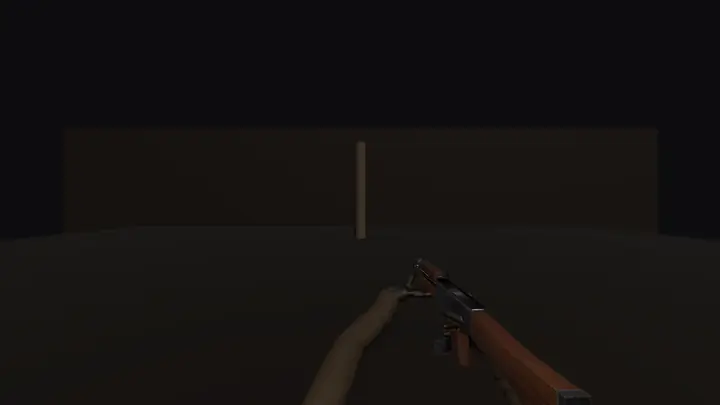

# ARCANGELO-47

The Arcangelo is a heavier assault rifle than the Malleus: it hits for 42 with iron sights only.

## Numbers

| Grade | Class | Damage | Fire | Magazine | Sight |
| --- | --- | --- | --- | --- | --- |
| [III](../grades/grade-3.md) | assault rifle | 42 | auto or semi, 600 rpm | 30 | tangent iron sights |

## Standard and desert

The same weapon in both modes. In the desert it is in the armoury at twice the standard price. See [the desert](../modes/desert.md).

## Related

- [Weapon grades](../grades/grade-3.md): the grade it belongs to.
- [AR-9 MALLEUS](ar9-malleus.md): the assault rifle of grade II.
- [GLORIA](gloria.md): the battle rifle of grade IV.
