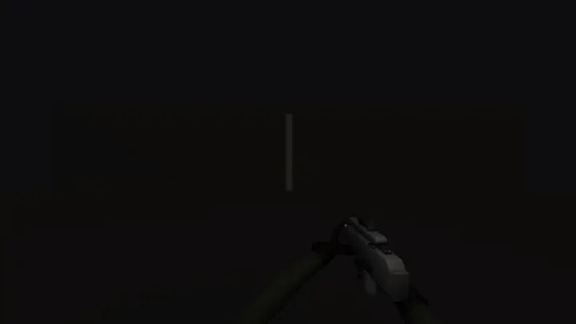

# BORDONE

The Bordone is a personal defence weapon in bullpup layout: a compact body with a long magazine above the grip.

## Numbers

| Grade | Class | Damage | Fire | Magazine | Sight |
| --- | --- | --- | --- | --- | --- |
| [III](../grades/grade-3.md) | PDW (bullpup) | 23 | auto, 900 rpm | 50 (top) | ring |

## Standard and desert

The same weapon in both modes. In the desert it is in the armoury at twice the standard price. See [the desert](../modes/desert.md).

## Related

- [Weapon grades](../grades/grade-3.md): the seven weapons of grade III.
- [ORIFIAMMA](orifiamma.md): the other bullpup of the same grade.
- [CAMPANA-249](campana-249.md): the light machine gun of grade IV, with a belt.
