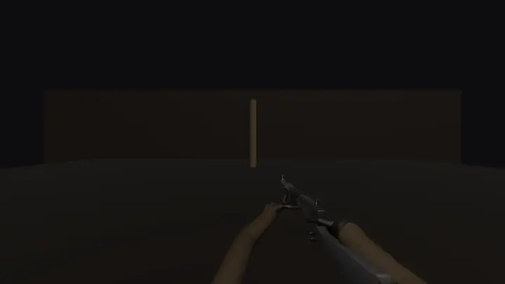

# BREACHER-12

The Breacher is a pump-action shotgun: each shot is eight pellets of 15 damage, and you work the pump between shots.

## Numbers

| Grade | Class | Damage | Fire | Magazine | Sight |
| --- | --- | --- | --- | --- | --- |
| [II](../grades/grade-2.md) | pump shotgun | 8 x 15 | pump | 8 (tube) | ghost ring |

Here 8 x 15 means eight pellets of 15 damage each.

## Standard and desert

The same weapon in both modes. In the desert it is in the armoury at twice the standard price. See [the desert](../modes/desert.md).

## Related

- [Weapon grades](../grades/grade-2.md): the grade it belongs to.
- [CAPPELLANO](cappellano.md): the double-barrel shotgun of the same grade.
- [APOCALISSE-12](apocalisse-12.md): the automatic drum shotgun of grade IV.
