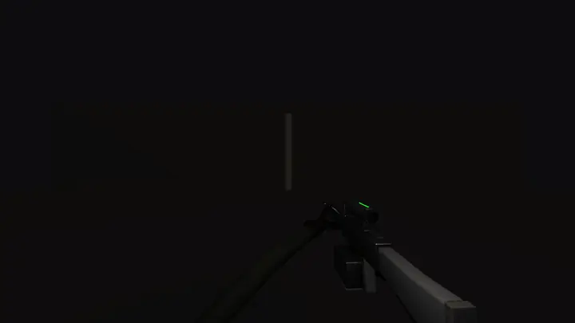

# CAMPANA-249

The Campana is a light machine gun with a belt of 100 rounds: long bursts, and enough ammunition to hold a room.

## Numbers

| Grade | Class | Damage | Fire | Magazine | Sight |
| --- | --- | --- | --- | --- | --- |
| [IV](../grades/grade-4.md) | light machine gun | 40 | auto, 780 rpm | 100 (belt) | 3x ACOG |

## Standard and desert

The same weapon in both modes. In the desert it is in the armoury at twice the standard price. See [the desert](../modes/desert.md).

## Related

- [Weapon grades](../grades/grade-4.md): the grade it belongs to.
- [SALTERIO](salterio.md): the drum machine gun of grade III.
- [The power-up Campana](../power-ups/campana.md): a bell, not this gun, that kills everyone around you.
