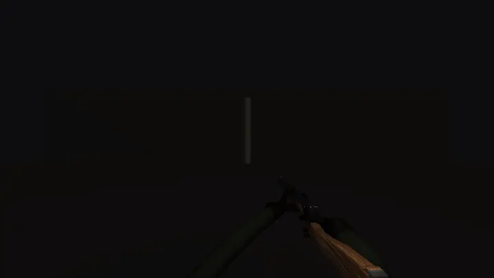

# CAPPELLANO

The Cappellano is a double-barrel shotgun: two barrels, one shot each, and a reload that breaks the gun open.

## Numbers

| Grade | Class | Damage | Fire | Magazine | Sight |
| --- | --- | --- | --- | --- | --- |
| [II](../grades/grade-2.md) | double-barrel shotgun | 10 x 14 | two barrels | 2 | bead sight |

Here 10 x 14 means ten pellets of 14 damage each.

## Standard and desert

The same weapon in both modes. In the desert it is in the armoury at twice the standard price. See [the desert](../modes/desert.md).

## Related

- [Weapon grades](../grades/grade-2.md): the grade it belongs to.
- [BREACHER-12](breacher-12.md): the pump shotgun of the same grade.
- [MARTELLO-12](martello-12.md): the semi-automatic shotgun of grade III.
