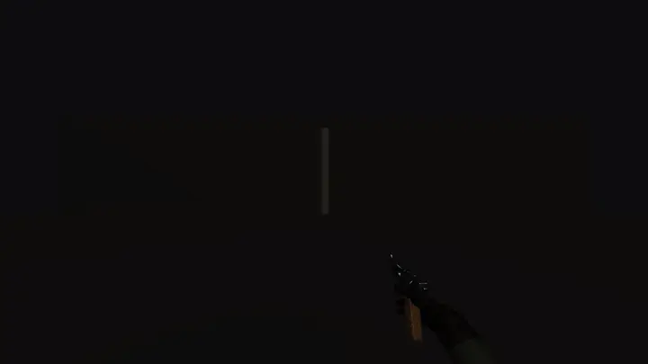

# CARDINALE .357

The Cardinale is a revolver: each shot hits hard enough to pierce the enemy behind the one it hits.

## Numbers

| Grade | Class | Damage | Fire | Magazine | Sight |
| --- | --- | --- | --- | --- | --- |
| [II](../grades/grade-2.md) | revolver | 70, pierces | semi | 6 (cylinder) | notch and ramp |

## Standard and desert

The same revolver in both modes. The desert's sand gives only grade I weapons for free, so the Cardinale is found there in the armoury,
at twice the standard price. See [the desert](../modes/desert.md).

## Related

- [Weapon grades](../grades/grade-2.md): the ten weapons of grade II.
- [EREMITA .50](eremita-50.md): the magnum of the next grade.
- [The Cardinale](../enemies/cardinale.md): the enemy that shares its name with the revolver.
