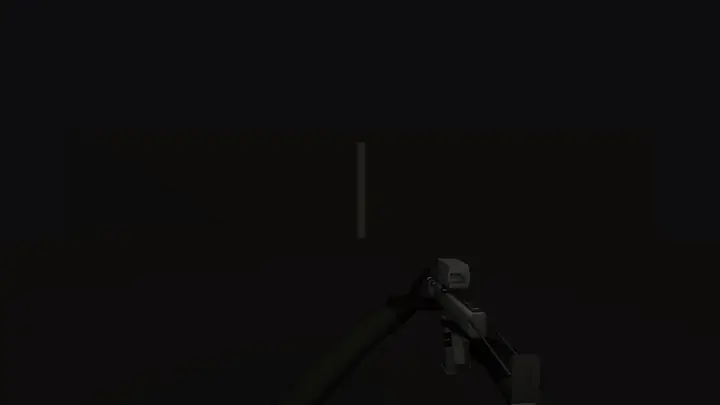

# CIMBALO-45

The Cimbalo is a submachine gun that hits harder than the Vesper: fewer rounds a minute, but nearly thirty damage each.

## Numbers

| Grade | Class | Damage | Fire | Magazine | Sight |
| --- | --- | --- | --- | --- | --- |
| [II](../grades/grade-2.md) | SMG | 29 | auto or semi, 620 rpm | 25 | holographic |

## Standard and desert

The same weapon in both modes, with the same numbers. The desert sells it in the armoury at twice the standard price. See
[the desert](../modes/desert.md).

## Related

- [Weapon grades](../grades/grade-2.md): the grade it belongs to.
- [VESPER-9](vesper-9.md): the other SMG of grade II.
- [The forge](../works/la-forgia.md): the work that adds damage to it.
