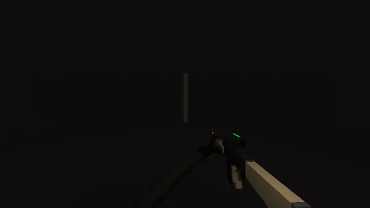

# GLORIA

The Gloria is a battle rifle: a heavy round in automatic or semi-automatic fire, with a 4x optic for the distance.

## Numbers

| Grade | Class | Damage | Fire | Magazine | Sight |
| --- | --- | --- | --- | --- | --- |
| [IV](../grades/grade-4.md) | battle rifle | 55 | auto or semi, 520 rpm | 20 | 4x ACOG |

## Standard and desert

The same weapon in both modes. In the desert it is in the armoury at twice the standard price. See [the desert](../modes/desert.md).

## Related

- [Weapon grades](../grades/grade-4.md): the grade it belongs to.
- [ARCANGELO-47](arcangelo-47.md): the assault rifle of grade III.
- [SENTINELLA](sentinella.md): the sniper rifle of the same grade.
