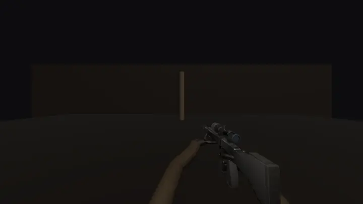

# LANCE-7

The Lance is a precision rifle: a scope and a shot that is meant to be aimed.

## Numbers

| Grade | Class | Damage | Fire | Magazine | Sight |
| --- | --- | --- | --- | --- | --- |
| [III](../grades/grade-3.md) | precision rifle | 72 | semi | 12 | 4x scope |

## Standard and desert

The same weapon in both modes. In the desert it is in the armoury at twice the standard price. See [the desert](../modes/desert.md).

## Related

- [Weapon grades](../grades/grade-3.md): the grade it belongs to.
- [SENTINELLA](sentinella.md): the sniper rifle of grade IV.
- [GLORIA](gloria.md): the battle rifle of grade IV with a 4x ACOG.
