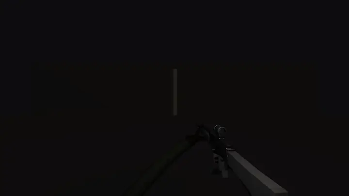

# MARTELLO-12

The Martello is a semi-automatic shotgun: each pull of the trigger fires a new shot, with a box magazine instead of a tube.

## Numbers

| Grade | Class | Damage | Fire | Magazine | Sight |
| --- | --- | --- | --- | --- | --- |
| [III](../grades/grade-3.md) | semi-automatic shotgun | 8 x 13 | semi | 8 (box) | red dot |

Here 8 x 13 means eight pellets of 13 damage each.

## Standard and desert

The same weapon in both modes. In the desert it is in the armoury at twice the standard price. See [the desert](../modes/desert.md).

## Related

- [Weapon grades](../grades/grade-3.md): the grade it belongs to.
- [BREACHER-12](breacher-12.md): the pump shotgun of grade II.
- [CAPPELLANO](cappellano.md): the double-barrel shotgun of grade II.
