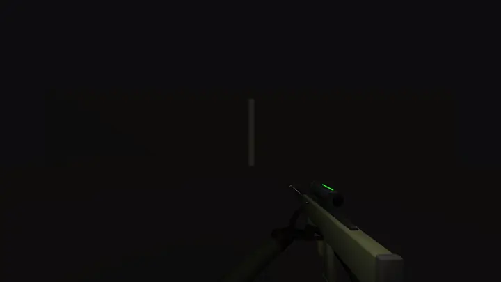

# ORIFIAMMA

The Orifiamma is a bullpup rifle with a magnifying optic of 1.5 times: a middle ground between a rifle and a carbine.

## Numbers

| Grade | Class | Damage | Fire | Magazine | Sight |
| --- | --- | --- | --- | --- | --- |
| [III](../grades/grade-3.md) | bullpup | 32 | auto or semi, 680 rpm | 30 | 1.5x optic |

## Standard and desert

The same weapon in both modes. In the desert it is in the armoury at twice the standard price. See [the desert](../modes/desert.md).

## Related

- [Weapon grades](../grades/grade-3.md): the grade it belongs to.
- [BORDONE](bordone.md): the other bullpup of the same grade.
- [Sights and the gunplay](../weapons/pieta-p9.md): the optics are shared by every weapon.
