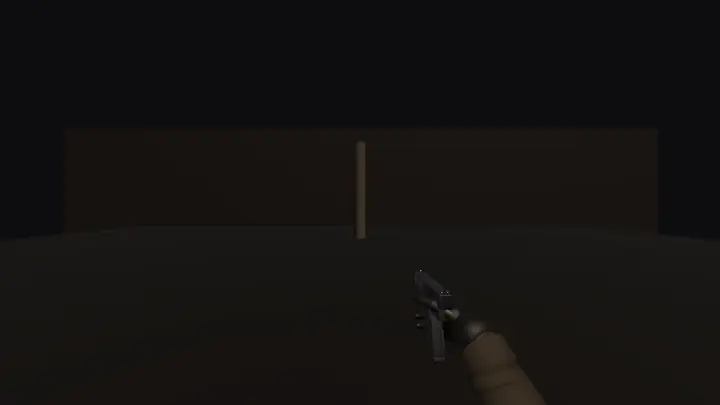

# PIETA' P-9

The P-9 is the pistol you start with. Every game gives it to you, and the armoury of the desert never sells it.

## Numbers

| Grade | Class | Damage | Fire | Magazine | Sight |
| --- | --- | --- | --- | --- | --- |
| [I](../grades/grade-1.md) | pistol | 25 | semi | 15 | three-dot iron sights |

## Standard and desert

The same pistol in both modes, and the starting weapon of both. The desert keeps the starting pistol out of the armoury, which sells
every other weapon at twice the standard price; see [the desert](../modes/desert.md).

## Related

- [Weapon grades](../grades/grade-1.md): the grade it belongs to, with the other two grade I weapons.
- [VIGILIA .45](vigilia-45.md): the other pistol of grade I.
- [Weapons in the armoury](../zones/cathedral.md#standard-and-desert): what the cathedral sells.
