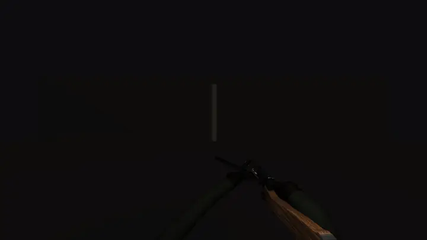

# PREDICATORE

The Predicatore is a lever-action carbine: one heavy shot at a time, reloaded round by round from a tube under the barrel.

## Numbers

| Grade | Class | Damage | Fire | Magazine | Sight |
| --- | --- | --- | --- | --- | --- |
| [II](../grades/grade-2.md) | lever-action carbine | 66, pierces 1 | lever | 8 (tube) | horn notch |

## Standard and desert

The same weapon in both modes. In the desert it is in the armoury at twice the standard price. See [the desert](../modes/desert.md).

## Related

- [Weapon grades](../grades/grade-2.md): the grade it belongs to.
- [ROSARIO](rosario.md): the bolt-action rifle of the same grade.
- [Ammunition crates](../pickups/ammunition-crate.md): the ammunition it uses on the sand.
