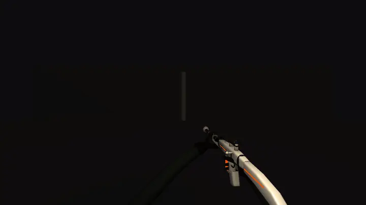

# PUPILLA

The Pupilla is a rifle with an eye in place of the muzzle. It fires a continuous amber beam, which goes through everything in its line.

## Numbers

| Grade | Class | Damage | Fire | Magazine | Sight |
| --- | --- | --- | --- | --- | --- |
| [V](../grades/grade-5.md) | eye-rifle with beam (special) | 90, pierces everything | semi, 210 rpm | 14 | amber ring |

The beam is synthetic in sound, and the weapon has no cartridge casings.

## Standard and desert

The same weapon in both modes. In the desert it is in the armoury at twice the standard price. See [the desert](../modes/desert.md).

## Related

- [Weapon grades](../grades/grade-5.md): the two weapons of the top grade.
- [ALTARE-50](altare-50.md): the other weapon of grade V.
- [TURIBOLO](turibolo.md): the other special weapon, the sacred flamethrower.
