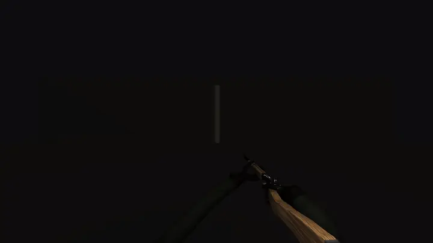

# ROSARIO

The Rosario is a bolt-action rifle: five rounds, and each shot does 118 damage.

## Numbers

| Grade | Class | Damage | Fire | Magazine | Sight |
| --- | --- | --- | --- | --- | --- |
| [II](../grades/grade-2.md) | bolt-action rifle | 118 | bolt | 5 | peep aperture |

## Standard and desert

The same weapon in both modes. In the desert it is in the armoury at twice the standard price. See [the desert](../modes/desert.md).

## Related

- [Weapon grades](../grades/grade-2.md): the grade it belongs to.
- [SENTINELLA](sentinella.md): the sniper rifle of grade IV.
- [PREDICATORE](predicatore.md): the carbine of the same grade.
