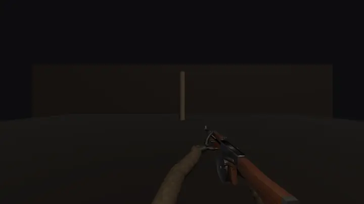

# SALTERIO

The Salterio is a light machine gun with a drum of 75 rounds: long bursts, slow to reload, and iron sights.

## Numbers

| Grade | Class | Damage | Fire | Magazine | Sight |
| --- | --- | --- | --- | --- | --- |
| [III](../grades/grade-3.md) | drum machine gun | 36 | auto, 640 rpm | 75 | iron sights |

## Standard and desert

The same weapon in both modes. In the desert it is in the armoury at twice the standard price. See [the desert](../modes/desert.md).

## Related

- [Weapon grades](../grades/grade-3.md): the grade it belongs to.
- [CAMPANA-249](campana-249.md): the light machine gun of grade IV, with a belt of 100.
- [Ammunition crates](../pickups/ammunition-crate.md): the ammunition for a drum on the sand.
