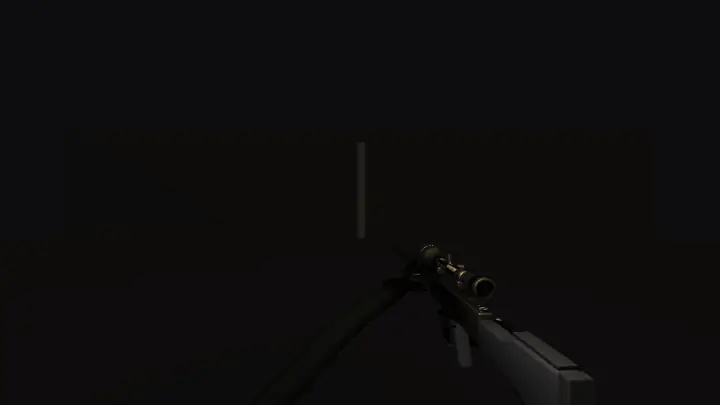

# SENTINELLA

The Sentinella is a sniper rifle: a bolt-action shot that goes through up to three enemies, from far away, with an 8x scope.

## Numbers

| Grade | Class | Damage | Fire | Magazine | Sight |
| --- | --- | --- | --- | --- | --- |
| [IV](../grades/grade-4.md) | sniper rifle | 190, pierces 3 | bolt | 5 | 8x scope |

## Standard and desert

The same weapon in both modes. In the desert it is in the armoury at twice the standard price. See [the desert](../modes/desert.md).

## Related

- [Weapon grades](../grades/grade-4.md): the grade it belongs to.
- [ROSARIO](rosario.md): the bolt-action rifle of grade II.
- [ALTARE-50](altare-50.md): the anti-materiel rifle of grade V.
