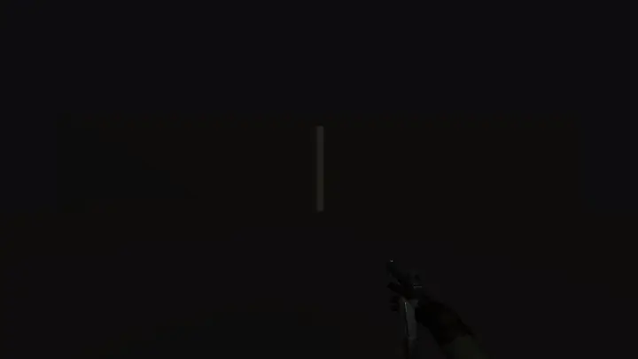

# SERAFINO-18

The Serafino is a machine pistol: a pistol that fires in bursts of automatic fire, with a short magazine and a red dot.

## Numbers

| Grade | Class | Damage | Fire | Magazine | Sight |
| --- | --- | --- | --- | --- | --- |
| [II](../grades/grade-2.md) | machine pistol | 16 | auto, 1000 rpm | 20 | open red dot |

## Standard and desert

The same weapon in both modes. In the desert it is sold in the armoury at twice the standard price; the sand does not give grade II
weapons for free, except in a boss hall. See [the desert](../modes/desert.md).

## Related

- [Weapon grades](../grades/grade-2.md): the grade it belongs to.
- [TARANTOLA](tarantola.md): the micro-SMG of grade I.
- [VESPER-9](vesper-9.md): the SMG of the same grade.
