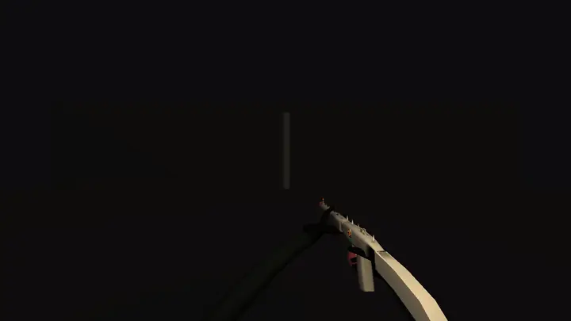

# SPORA

The Spora is a launcher made of bone and flesh. It fires a fan of seven green needles, one shot at a time.

## Numbers

| Grade | Class | Damage | Fire | Magazine | Sight |
| --- | --- | --- | --- | --- | --- |
| [IV](../grades/grade-4.md) | alien spine launcher (special) | 7 x 21 spines | semi, 140 rpm | 6 | iron sights |

Here 7 x 21 means seven needles of 21 damage each.

## Standard and desert

The same weapon in both modes. In the desert it is in the armoury at twice the standard price. See [the desert](../modes/desert.md).

## Related

- [Weapon grades](../grades/grade-4.md): the six weapons of grade IV.
- [TURIBOLO](turibolo.md): the other special weapon, of grade III.
- [PUPILLA](pupilla.md): the eye-rifle of grade V.
