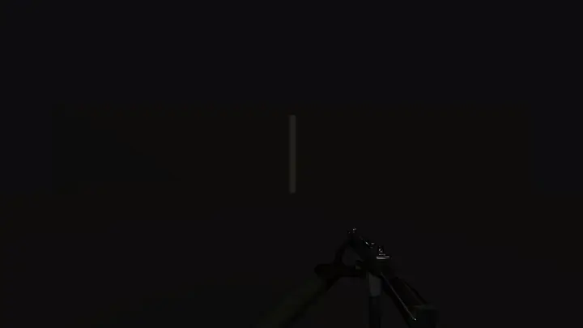

# TARANTOLA

The Tarantola is a micro-SMG: small hits, very fast, with a long magazine. It is the grade I weapon that keeps a room busy.

## Numbers

| Grade | Class | Damage | Fire | Magazine | Sight |
| --- | --- | --- | --- | --- | --- |
| [I](../grades/grade-1.md) | micro-SMG | 13 | auto, 1150 rpm | 32 | peep aperture |

## Standard and desert

The same weapon in both modes. The desert's free weapons are of grade I, so the Tarantola can be found on the sand; the armoury sells
it at twice the standard price. See [the desert](../modes/desert.md).

## Related

- [Weapon grades](../grades/grade-1.md): the grade it belongs to.
- [SERAFINO-18](serafino-18.md) and [VESPER-9](vesper-9.md): the grade II weapons of the same kind.
- [The sacristy](../works/la-sacrestia.md): the rack of free weapons in the cathedral.
