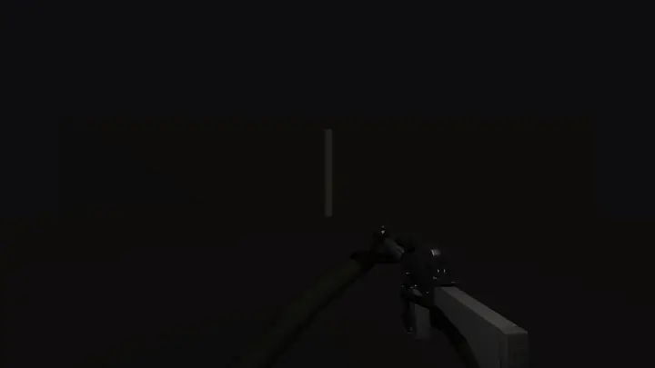

# TRINITA'

The Trinità fires three rounds with each pull of the trigger: a burst rifle, aimed and precise.

## Numbers

| Grade | Class | Damage | Fire | Magazine | Sight |
| --- | --- | --- | --- | --- | --- |
| [II](../grades/grade-2.md) | burst rifle | 36 | 3-round burst | 30 | carry handle with peep |

## Standard and desert

The same weapon in both modes. In the desert it is in the armoury at twice the standard price. See [the desert](../modes/desert.md).

## Related

- [Weapon grades](../grades/grade-2.md): the grade it belongs to.
- [AR-9 MALLEUS](ar9-malleus.md): the assault rifle of the same grade.
- [La Forgia](../works/la-forgia.md): the work that adds damage to every weapon.
