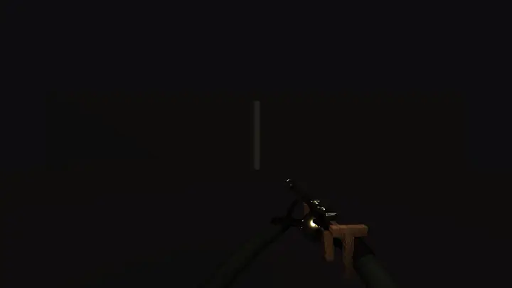

# TURIBOLO

The Turibolo is a censer turned into a flamethrower: the chain swings, and the fire is a jet that goes through the enemies lined up in
front of it, over a short range.

## Numbers

| Grade | Class | Damage | Fire | Magazine | Sight |
| --- | --- | --- | --- | --- | --- |
| [III](../grades/grade-3.md) | sacred flamethrower (special) | 9 per tick, pierces 4 | auto, 1100 rpm, range 11 m | 120 (tank) | iron sights |

The fire is a jet of additive quads and its sound is synthetic; there are no cartridge casings.

## Standard and desert

The same weapon in both modes. In the desert it is in the armoury at twice the standard price. See [the desert](../modes/desert.md).

## Related

- [Weapon grades](../grades/grade-3.md): the grade it belongs to.
- [SPORA](spora.md) and [PUPILLA](pupilla.md): the other two special weapons.
- [The sacristy](../works/la-sacrestia.md): the rack in the cathedral.
