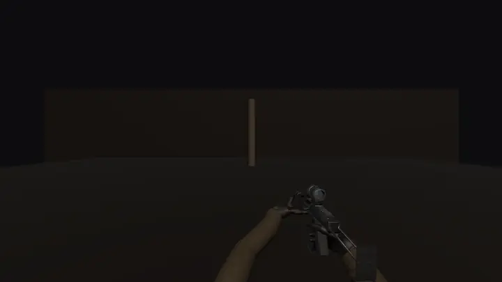

# VESPER-9

The Vesper is a submachine gun with a long magazine: steady damage, and enough rounds to last a whole wave.

## Numbers

| Grade | Class | Damage | Fire | Magazine | Sight |
| --- | --- | --- | --- | --- | --- |
| [II](../grades/grade-2.md) | SMG | 20 | auto, 850 rpm | 40 | red dot |

## Standard and desert

The same weapon in both modes. In the desert it is in the armoury, at twice the standard price, like the other grade II weapons. See
[the desert](../modes/desert.md).

## Related

- [Weapon grades](../grades/grade-2.md): the grade it belongs to.
- [CIMBALO-45](cimbalo-45.md): the other SMG of grade II.
- [Ammunition crates](../pickups/ammunition-crate.md): the ammunition for it on the sand.
