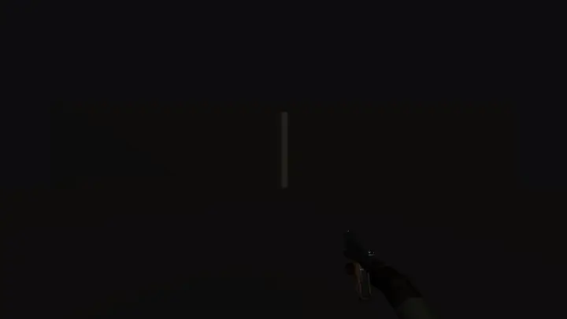

# VIGILIA .45

The Vigilia is a heavier pistol than the P-9: it hits harder and holds fewer rounds.

## Numbers

| Grade | Class | Damage | Fire | Magazine | Sight |
| --- | --- | --- | --- | --- | --- |
| [I](../grades/grade-1.md) | pistol | 38 | semi | 8 | fixed iron sights |

## Standard and desert

The same pistol in both modes. On the sand it can be found as a grade I weapon, for free and a few at a time; in the armoury of the cathedral it
costs twice the standard price. See [the desert](../modes/desert.md).

## Related

- [PIETA' P-9](pieta-p9.md): the starting pistol.
- [Weapon grades](../grades/grade-1.md): the three weapons of grade I.
- [The forge](../works/la-forgia.md): the work that adds damage to every weapon.
