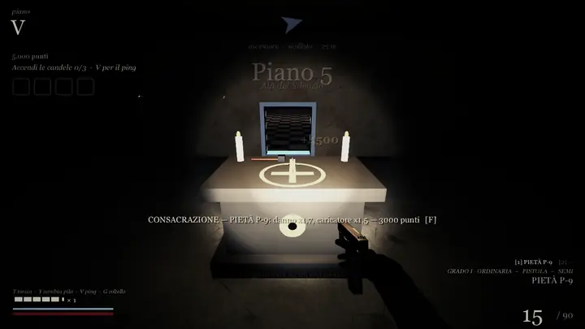

# L'Altare della Consacrazione

The Altar of Consecration is the Pack-a-Punch of the game: it makes the weapon in your hand stronger, for points, once per weapon.
The standard game has it on the floors of the catacombs; the desert has it as a work of the cathedral.

## In the cathedral

- **Place:** the presbytery.
- **Cost:** 40 steel, 5 embers, 3 hearts and 1 relic. It needs [L'Altare maggiore](laltare-maggiore.md) to stand first.
- **Effect:** the altar consecrates the weapon in your hand for 3000 points, once per weapon. The catalogue calls it the
  pack-a-punch: the upgrade is paid in points, and each weapon takes it only once.

## Standard and desert

This work exists only in the desert. In the standard game the same altar stands on the floors of the catacombs, in the
[secret room](../rooms/secret-room.md) on the candle-cycle grid and elsewhere on the wave-cycle floors, where that room does not
exist. The desert gives the same price, 3000 points, once per weapon. See [the desert](../modes/desert.md) and
[the forge](la-forgia.md), which adds damage in the cathedral.

## Related

- [L'Altare maggiore](laltare-maggiore.md): the altar it needs, which the desert also has.
- [Biblioteca dei Voti](biblioteca-dei-voti.md): the other work only the desert has.
- [Weapon grades](../grades/grade-1.md): the five grades a weapon can be in.
