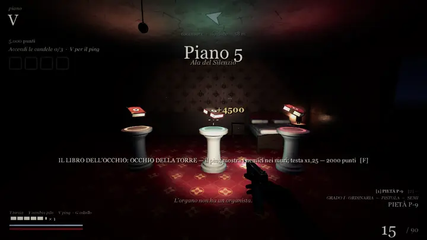

# La Biblioteca dei Voti

The Library of Vows exists only in the desert. In the standard game the perk books are found in the catacombs' libraries; in the
desert they are built into the cathedral, and bought with the points you carry.

## In the cathedral

- **Place:** the nave.
- **Cost:** 30 wood, 30 bones and 2 blood. It is built with the resources brought from the sand, at the exact payment.
- **Effect:** the perk books return to three lecterns in the nave. A book costs more with each perk you already hold: 2000, 2500,
  3000 and 4000 points for the four perk slots. Taking one closes the other two; 45 seconds later, with you away from the lecterns,
  three new books are offered.

## Standard and desert

Only the desert has this work. The standard game has the same kind of library on the floors of the catacombs: a library room with
three lecterns and the same four prices. In the desert the books are a work of the cathedral, bought with points. See
[the desert](../modes/desert.md) and [the perks](../perks/velo.md).

## Related

- [La Cappella delle Mani](la-cappella-delle-mani.md) and [La Cappella della Pietra](la-cappella-della-pietra.md): the chapels that
  give a perk at the start of a catacomb expedition.
- [Perks](../perks/velo.md): the eight perks that the books and the chapels give.
- [The cathedral](../zones/cathedral.md): where the Library stands in the desert.
