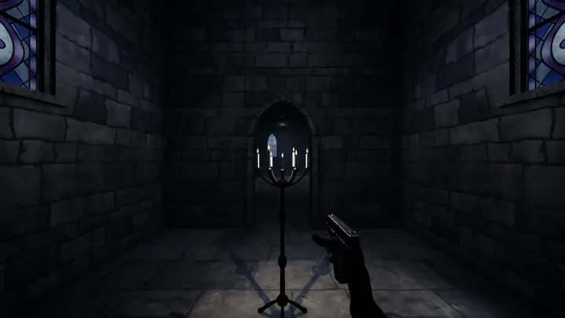

# Il Campanile

Until it is built the bell tower is a stump. Once built, its bell is the third way back up from the catacombs.

## In the cathedral

- **Place:** the bell tower.
- **Cost:** 40 steel, 30 wood, 5 embers and 1 relic.
- **Needs:** [Le Volte della navata](le-volte-della-navata.md).
- **Effect:** the return bell. Once per expedition, from the pause menu, even in the middle of a wave, it takes you back to the
  cathedral with the satchel banked.

## Standard and desert

The same work stands in the cathedral in both modes, but the bell only brings you back from a catacomb expedition, and the desert has
none. See [the desert](../modes/desert.md).

## Related

- [The catacombs](../zones/catacombs.md): the expeditions the bell returns you from.
- [Brace](../resources/brace.md) and [Reliquie](../resources/reliquie.md): the rare resources it needs.
- [Il Cancello del Teatro](il-cancello-del-teatro.md): the other work that costs a relic.
