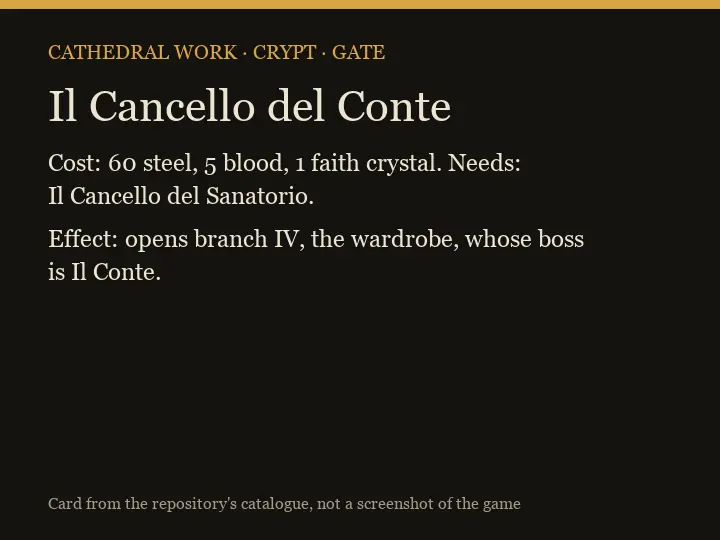

# Il Cancello del Conte

The last branch gate. It opens [Il Guardaroba del Conte](../branches/guardaroba.md), the fourth branch, the one with the wardrobes.

## In the cathedral

- **Place:** the crypt.
- **Cost:** 60 steel, 5 blood and 1 faith crystal.
- **Needs:** [Il Cancello del Sanatorio](il-cancello-del-sanatorio.md).
- **Effect:** opens branch IV, Il Guardaroba del Conte, whose boss, the Conte, gives the gems.

## Standard and desert

The same work in both modes. The desert does not build the descent gates, and it has no branch IV; see [the desert](../modes/desert.md).

## Related

- [Cristalli di fede](../resources/cristalli-di-fede.md): the faith crystal it costs, which only the Primario drops.
- [La Vetrata del Conte](la-vetrata-del-conte.md): the window the Count's gems go to.
- [The catacombs](../zones/catacombs.md): the four branches.
