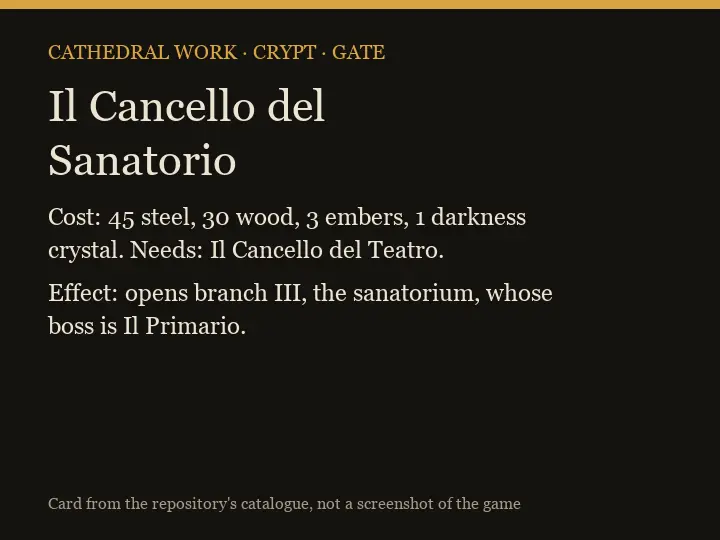

# Il Cancello del Sanatorio

The second branch gate. It opens [Il Sanatorio](../branches/sanatorio.md), the third branch.

## In the cathedral

- **Place:** the crypt.
- **Cost:** 45 steel, 30 wood, 3 embers and 1 darkness crystal.
- **Needs:** [Il Cancello del Teatro](il-cancello-del-teatro.md).
- **Effect:** opens branch III, Il Sanatorio.

## Standard and desert

The same work in both modes. In the desert the descent gates are not built, so the branch it opens does not exist there; see
[the desert](../modes/desert.md).

## Related

- [Cristalli d'oscurità](../resources/cristalli-d-oscurita.md): the darkness crystal it costs, which only the Direttore drops.
- [Il Cancello del Conte](il-cancello-del-conte.md): the gate after this one.
- [The catacombs](../zones/catacombs.md): the branches the gates open.
