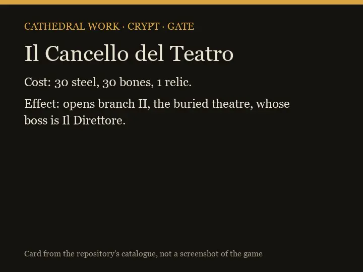

# Il Cancello del Teatro

The first of the three branch gates. Until it is built, the gate to [Il Teatro sepolto](../branches/teatro-sepolto.md) is walled.

## In the cathedral

- **Place:** the crypt.
- **Cost:** 30 steel, 30 bones and 1 relic. No prerequisite.
- **Effect:** opens branch II, Il Teatro sepolto, whose boss, the Direttore, gives the darkness crystals.

## Standard and desert

The same work stands in the cathedral in both modes. The desert does not build the descent gates, so there is no gate to open and no
branch to enter there; see [the desert](../modes/desert.md) and [the cathedral](../zones/cathedral.md#standard-and-desert).

## Related

- [Il Cancello del Sanatorio](il-cancello-del-sanatorio.md): the gate this one leads to.
- [Reliquie](../resources/reliquie.md): the relic it costs, which only the Cardinale drops.
- [The catacombs](../zones/catacombs.md): the descent the gates open.
