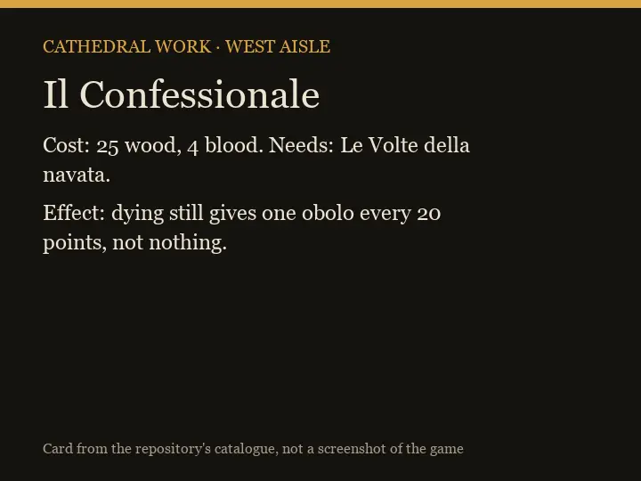

# Il Confessionale

The confessional of the west aisle. It softens the worst part of dying in the catacombs: the points you did not spend are normally
lost, and with the confessional some of them survive.

## In the cathedral

- **Place:** the west aisle.
- **Cost:** 25 wood and 4 blood.
- **Needs:** [Le Volte della navata](le-volte-della-navata.md).
- **Effect:** when you die, your unspent points still give one obolo every 20 points.

## Standard and desert

The same work in both modes. The rule it changes is the death of a catacomb expedition, which the desert does not have; the desert
ends its death with half of the points and the last perk (see [the desert](../modes/desert.md)).

## Related

- [Points and oboli](../pickups/points.md): the points the confessional protects.
- [L'Ossario](lossario.md): the crypt work that protects the resources instead.
- [Acciaio](../resources/acciaio.md) and [Sangue](../resources/sangue.md): the costs.
