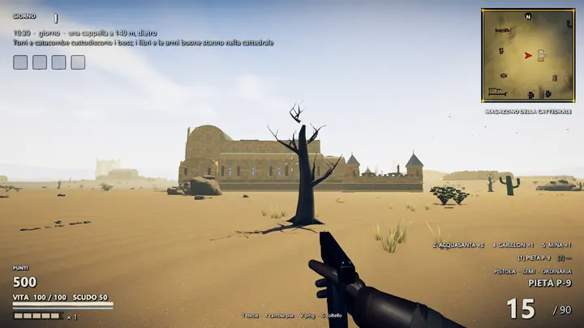

# Il Rosone

The rose window is the last work of the standard game. Building it consecrates the cathedral, and under the crypt the Abyss opens.

## In the cathedral

- **Place:** the façade.
- **Cost:** 3 relics, 3 darkness crystals, 3 faith crystals and 3 gems, plus 100 bones, 100 wood and 100 steel.
- **Needs:** the four stained-glass windows of the bosses: [Cardinale](la-vetrata-del-cardinale.md), [Direttore](la-vetrata-del-direttore.md),
  [Primario](la-vetrata-del-primario.md) and [Conte](la-vetrata-del-conte.md).
- **Effect:** the cathedral is consecrated, and the [Abyss](../zones/abyss.md) opens under the crypt: the bottomless catacombs.

## Standard and desert

Only the standard game has the Abyss, so the consecration has no Abyss to open in the desert. The desert keeps the cathedral and its
works as they are; see [the desert](../modes/desert.md).

## Related

- [The Abyss](../zones/abyss.md): what the work opens.
- [The four boss resources](../resources/reliquie.md): the rarest part of its cost.
- [The cathedral](../zones/cathedral.md): the façade it stands on.
