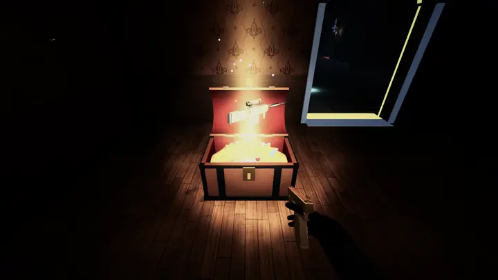

# Il Tesoro

The treasury keeps the coins of the catacombs. When you come back alive, the unspent points are turned into oboli, and the treasury
makes the exchange better.

## In the cathedral

- **Place:** the sacristy.
- **Cost:** 30 steel, 30 bones and 2 hearts.
- **Needs:** [La Sacrestia](la-sacrestia.md).
- **Effect:** one obolo for every 6 points, instead of one for every 10, when you climb back alive.

## Standard and desert

The same work in both modes, but the rule it changes belongs to the catacombs: the desert has no return from an expedition to turn
points into oboli. See [the desert](../modes/desert.md) and [the points](../pickups/points.md).

## Related

- [The cathedral's market](../stalls/speziale.md): where the oboli are spent.
- [Cuori](../resources/cuori.md): the rare hearts it needs.
- [L'Ossario](lossario.md) and [Il Confessionale](il-confessionale.md): the other works that protect what you bring home.
