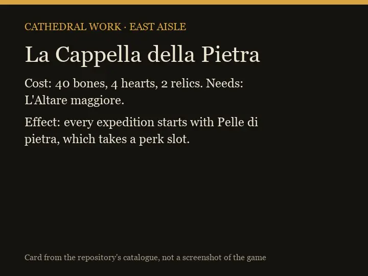

# La Cappella della Pietra

The first of the two chapels of the east aisle. It gives you a perk before you go down.

## In the cathedral

- **Place:** the east aisle.
- **Cost:** 40 bones, 4 hearts and 2 relics.
- **Needs:** [L'Altare maggiore](laltare-maggiore.md).
- **Effect:** every expedition starts with the [Pelle di pietra](../perks/pelle-di-pietra.md) perk. It takes one perk slot.

## Standard and desert

The same work in both modes. The desert has no expeditions, so the perk it gives at their start has no start to act on there; the
desert's own perks come from the books of its Library of Vows. See [the desert](../modes/desert.md).

## Related

- [La Cappella delle Mani](la-cappella-delle-mani.md): the other chapel of the east aisle.
- [Perks](../perks/pelle-di-pietra.md): the eight perks of the books and the chapels.
- [Reliquie](../resources/reliquie.md): the relics it costs.
