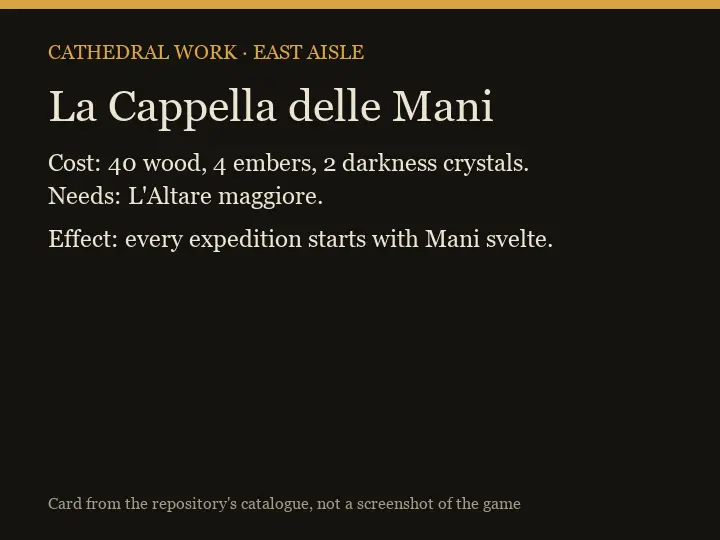

# La Cappella delle Mani

The second chapel of the east aisle. It gives you quicker hands before you go down.

## In the cathedral

- **Place:** the east aisle.
- **Cost:** 40 wood, 4 embers and 2 darkness crystals.
- **Needs:** [L'Altare maggiore](laltare-maggiore.md).
- **Effect:** every expedition starts with the [Mani svelte](../perks/mani-svelte.md) perk.

## Standard and desert

The same work in both modes. As with its sister chapel, the perk is for the start of a catacomb expedition, which the desert does not
have; see [the desert](../modes/desert.md).

## Related

- [La Cappella della Pietra](la-cappella-della-pietra.md): the other chapel of the east aisle.
- [Cristalli d'oscurità](../resources/cristalli-d-oscurita.md): the darkness crystals it costs.
- [Perks](../perks/mani-svelte.md): what the chapels and the books give.
