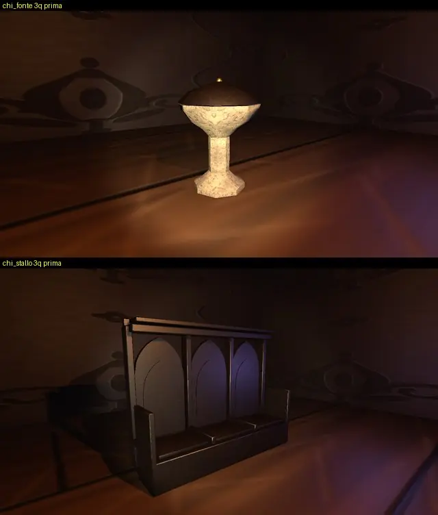

# La Fonte battesimale

The font of the baptistery. It is the first work that gives something in the catacombs: holy water, the throwable that burns the
enemies it hits.

## In the cathedral

- **Place:** the baptistery.
- **Cost:** 15 bones, 15 steel and 2 blood. No prerequisite.
- **Effect:** at least three [holy waters](../throwables/holy-water.md) are available on every level of the catacombs.

## Standard and desert

The same work, with the same cost and effect, in both modes: the desert keeps the cathedral and its works. The effect is about the
catacomb levels, which exist only in the standard game; see [the desert](../modes/desert.md).

## Related

- [The cathedral](../zones/cathedral.md): where the font stands.
- [Ossa](../resources/ossa.md) and [Acciaio](../resources/acciaio.md): the common resources it costs.
- [La Sacrestia](la-sacrestia.md): the next work of the baptistery's side of the church.
