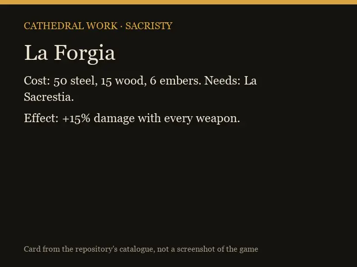

# La Forgia

The forge of the sacristy. It is the damage work: every weapon you carry down the catacombs hits harder.

## In the cathedral

- **Place:** the sacristy.
- **Cost:** 50 steel, 15 wood and 6 embers.
- **Needs:** [La Sacrestia](la-sacrestia.md).
- **Effect:** +15% damage with every weapon. With the forge built, one of the three weapons of the sacristy's rack is of grade 3
  instead of grade 2.

## Standard and desert

The same work, with the same cost and effect, in both modes. The desert keeps the cathedral and its works; see
[the desert](../modes/desert.md).

## Related

- [The weapon grades](../grades/grade-3.md): what the forge does to the rack.
- [Brace](../resources/brace.md): the rare embers it needs.
- [Il Tesoro](il-tesoro.md): the other work of the sacristy.
