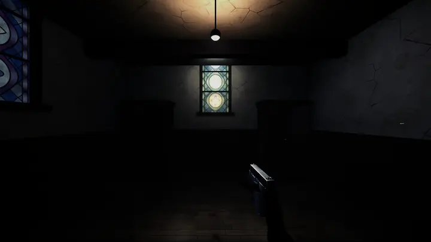

# La Sacrestia

The sacristy keeps the weapons of the church. It is the door to the two works that need its rack and its forge.

## In the cathedral

- **Place:** the sacristy.
- **Cost:** 30 wood and 25 steel. No prerequisite.
- **Effect:** a rack of three free weapons better than the starting pistol, one to take down on the way out. They are of grade 2; with
  [La Forgia](la-forgia.md) built, one of them is of grade 3. The grades are explained in [the weapon grades](../grades/grade-2.md).

## Standard and desert

The same work in both modes. In the desert the sand gives free weapons only of grade I (grade II in a boss hall), while the rack of
the sacristy stays in the cathedral; the [armoury](../zones/cathedral.md#standard-and-desert) sells the rest at twice the price.
See [the desert](../modes/desert.md).

## Related

- [La Forgia](la-forgia.md) and [Il Tesoro](il-tesoro.md): the other two works of the sacristy.
- [Weapons](../weapons/pieta-p9.md): the 28 models the rack chooses from.
- [Acciaio](../resources/acciaio.md) and [Legno](../resources/legno.md): what it costs.
