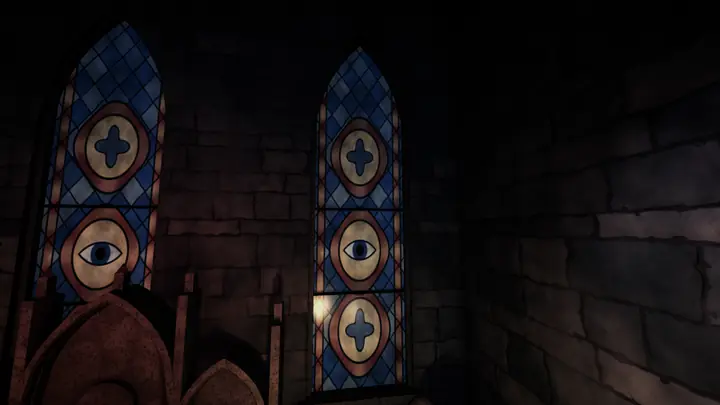

# La Vetrata del Cardinale

One of the four stained-glass windows of the bosses. It is made with the relics of the first branch's boss, and it shows the coloured
light of the window in the nave only once it is made.

## In the cathedral

- **Place:** the nave clerestory.
- **Cost:** 3 relics and 20 wood.
- **Needs:** [Le Volte della navata](le-volte-della-navata.md).
- **Effect:** +25% damage to bosses, with every weapon.

## Standard and desert

The same work stands in the cathedral in both modes. The desert's own bosses sit in its stacks; the desert page does not say whether
the +25% reaches them. See [the desert](../modes/desert.md).

## Related

- [Reliquie](../resources/reliquie.md): the relics it costs, which only the [Cardinale](../enemies/cardinale.md) drops.
- [The Cardinale's branch](../branches/ossario.md): the boss of the first branch.
- [Il Rosone](il-rosone.md): the work that needs all four windows.
