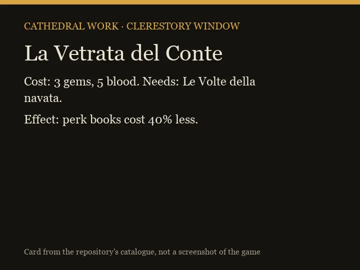

# La Vetrata del Conte

The window of the wardrobe's boss. It makes the perk books cheaper, which is where the perks of the catacombs come from.

## In the cathedral

- **Place:** the nave clerestory.
- **Cost:** 3 gems and 5 blood.
- **Needs:** [Le Volte della navata](le-volte-della-navata.md).
- **Effect:** perk books cost 40% less.

## Standard and desert

The same work stands in the cathedral in both modes. The desert's perk books are on the lecterns of its own
[Library of Vows](biblioteca-dei-voti.md) and are bought with points; the desert page does not say whether the discount reaches
those prices. See [the desert](../modes/desert.md).

## Related

- [Gemme](../resources/gemme.md): the gems it costs, which only the Conte drops.
- [Il Guardaroba del Conte](../branches/guardaroba.md): the branch of the Conte.
- [Perks](../perks/velo.md): the perks the books give.
