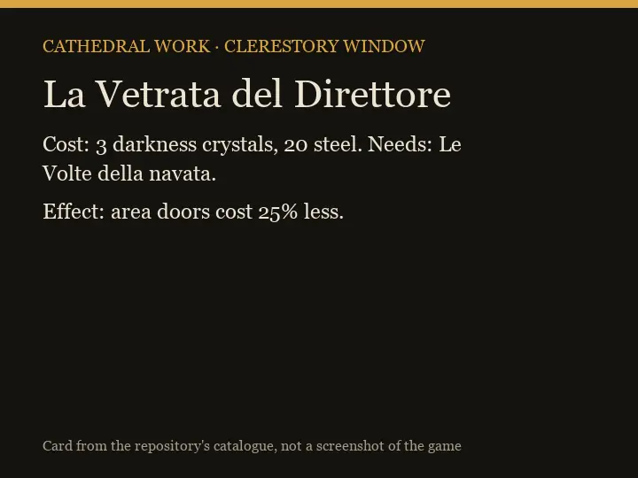

# La Vetrata del Direttore

The window of the theatre's boss. It makes the paid doors of the catacombs cheaper.

## In the cathedral

- **Place:** the nave clerestory.
- **Cost:** 3 darkness crystals and 20 steel.
- **Needs:** [Le Volte della navata](le-volte-della-navata.md).
- **Effect:** area doors cost 25% less. The paid doors are described in [the paid doors](../doors/area-door.md).

## Standard and desert

The same work stands in the cathedral in both modes. The area doors are the paid doors of the catacombs' levels; the desert page
does not describe them. See [the desert](../modes/desert.md).

## Related

- [Cristalli d'oscurità](../resources/cristalli-d-oscurita.md): the crystals it costs, which only the [Direttore](../enemies/direttore.md) drops.
- [Il Teatro sepolto](../branches/teatro-sepolto.md): the branch of the Direttore.
- [Il Cancello del Sanatorio](il-cancello-del-sanatorio.md): the gate that needs the crystals.
