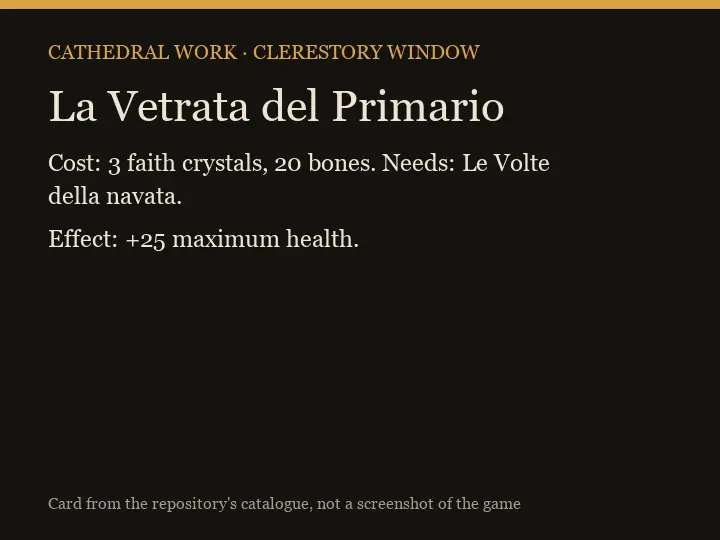

# La Vetrata del Primario

The window of the sanatorium's boss. It raises the health you start every descent with.

## In the cathedral

- **Place:** the nave clerestory.
- **Cost:** 3 faith crystals and 20 bones.
- **Needs:** [Le Volte della navata](le-volte-della-navata.md).
- **Effect:** +25 maximum health.

## Standard and desert

The same work in both modes. Maximum health is the player's own, so the bonus applies in the desert as well; see
[the desert](../modes/desert.md).

## Related

- [Cristalli di fede](../resources/cristalli-di-fede.md): the faith crystals it costs, which only the [Primario](../enemies/primario.md) drops.
- [Il Sanatorio](../branches/sanatorio.md): the branch of the Primario.
- [Blessings](../blessings/grazia.md): the altar's blessing that also gives health.
