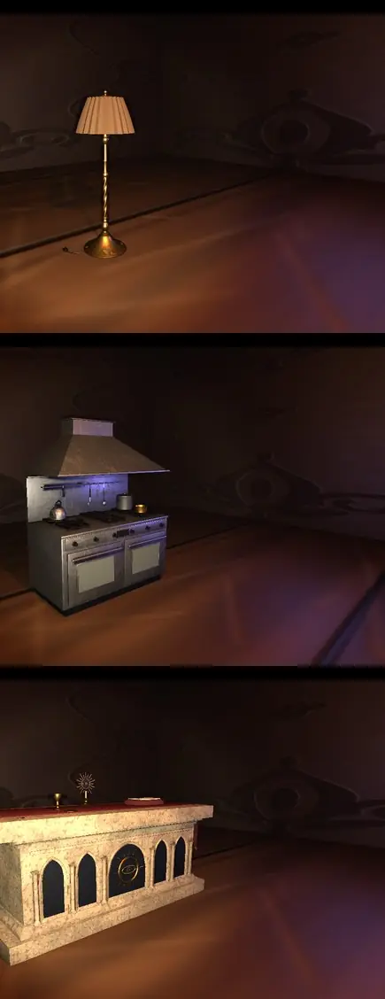

# L'Altare maggiore

The high altar in the presbytery. Once built, it is where you choose the blessing of the expedition: before each descent you light one
of three candles, and the one you light lasts the whole descent.

## In the cathedral

- **Place:** the presbytery.
- **Cost:** 30 bones, 20 wood and 3 hearts.
- **Needs:** [Le Volte della navata](le-volte-della-navata.md).
- **Effect:** three of the six [blessings](../blessings/furia.md) are offered after every return; the lit candle keeps its blessing for
  the next expedition.

## Standard and desert

The same work stands in both modes, but the blessing has nothing to bless in the desert, which has no catacomb expeditions. The desert
has its own altar in the cathedral, the [Altar of Consecration](altare-della-consacrazione.md), which consecrates the weapon in your
hand. See [the desert](../modes/desert.md).

## Related

- [The blessings](../blessings/furia.md): the six that the altar offers.
- [Cuori](../resources/cuori.md): the rare resource it needs.
- [The cathedral](../zones/cathedral.md): where the altar stands.
