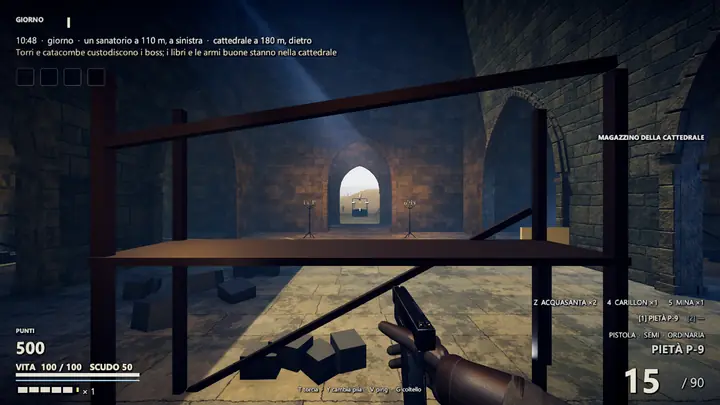

# Le Volte della navata

The vaults of the nave. Until they are built the nave is open to the night sky. Several works need them first.

## In the cathedral

- **Place:** the nave.
- **Cost:** 40 wood and 20 steel. No prerequisite.
- **Effect:** the nave gets its roof back, and every expedition starts with 250 more points.

## Standard and desert

The same work, with the same cost and effect, in both modes. The desert keeps the cathedral, its works and its store as the usual
ones, so the vaults are built there with the same resources; see [the desert](../modes/desert.md).

## Related

- [The cathedral](../zones/cathedral.md): where the work stands.
- [L'Organo](lorgano.md), [Il Campanile](il-campanile.md) and [La Vetrata del Conte](la-vetrata-del-conte.md): works that need the vaults first.
- [Resources](../resources/legno.md): the wood it costs.
