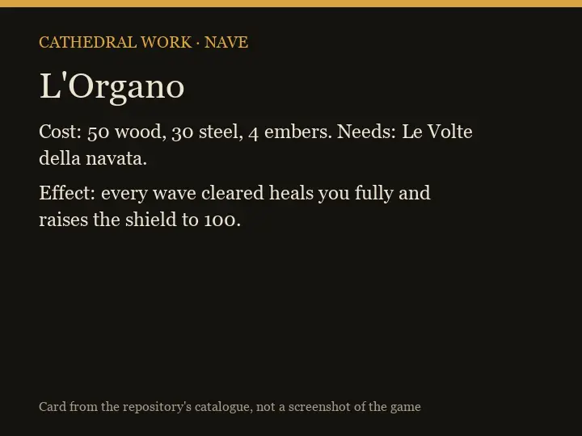

# L'Organo

The organ of the nave. Its music, in the catacombs, is a heal at the end of every wave.

## In the cathedral

- **Place:** the nave.
- **Cost:** 50 wood, 30 steel and 4 embers.
- **Needs:** [Le Volte della navata](le-volte-della-navata.md).
- **Effect:** every wave you clear heals you fully and raises the shield to 100.

## Standard and desert

The same work stands in the cathedral in both modes. The desert has no wave cycle, so there is no wave for the organ to answer
there: its fights are with the enemies of the places and the open sand, which rest until you come near ([the desert](../modes/desert.md)).

## Related

- [Brace](../resources/brace.md): the rare embers it costs.
- [The wave cycle](../cycles/wave-cycle.md): the waves that the organ answers.
- [Le Volte della navata](le-volte-della-navata.md): the work it needs first.
