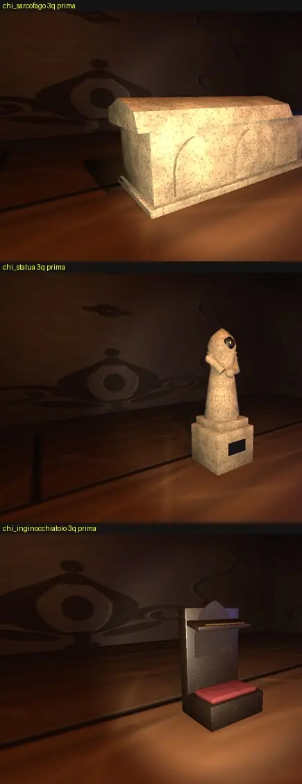

# L'Ossario (the crypt work)

The crypt work gives the first branch its name: [L'Ossario](../branches/ossario.md) is the branch that starts open from the
beginning. Building the crypt changes what death costs, which makes the first descents much less risky.

## In the cathedral

- **Place:** the crypt.
- **Cost:** 60 bones and 10 wood. No prerequisite.
- **Effect:** dying keeps all the common resources and half of the rare ones, instead of half of the common and none of the rare.

## Standard and desert

The same work, with the same effect, in both modes. The desert has no satchel to bring home, and its death costs half the points and
the last perk instead of the resources; see [the desert](../modes/desert.md).

## Related

- [L'Ossario, the first branch](../branches/ossario.md): the branch the crypt is named after.
- [Ossa](../resources/ossa.md) and [Legno](../resources/legno.md): the common resources it costs.
- [The cathedral](../zones/cathedral.md): where the crypt is.
