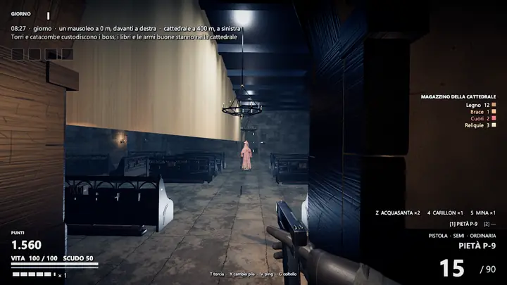

# The Abyss

The Abyss is the last zone of the standard game. It opens under the crypt when the cathedral is consecrated by the
[Rosone](../works/il-rosone.md), the last work to build. It has no branch of its own: each of its levels is drawn from the four
branches, and the bosses come in turn, one every three levels.

## How it plays

- The floors are generated like those of the branches, with the rules of the level they stand for.
- The gate of the third level of an Abyss stretch does not lead up: it goes on down. The boss's trophy goes to the store as in the
  branches.
- The boss of each third level gives its own resource, so the Abyss offers all four boss resources in turn.

## Standard and desert

The Abyss exists only in the standard game. The desert has no branches and no descent gates, so it has nothing for the Abyss to
draw from; its towers and catacombs are [stacks](../stacks/tower.md) with their own bosses. See [the desert](../modes/desert.md).

## Related

- [The catacombs](catacombs.md): the four branches the Abyss draws from.
- [The cathedral](cathedral.md): where the Rosone stands and where the descent begins.
- [Standard versus desert](../standard-vs-desert.md): the comparison of every kind.
