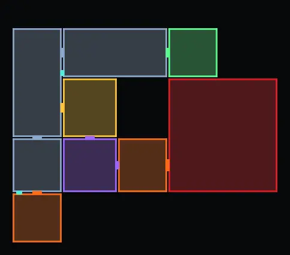

# The catacombs

The catacombs are the procedural floors of the standard game. They used to be reached by a lift in a tower; since 17 November 2026
they are reached by going down, through the gates behind the [cathedral](cathedral.md)'s apse. Every floor is generated from the seed
and is the same every time you come back to it.

## How a descent goes

1. You enter through an open gate, on the first level of a branch.
2. Each level plays like a floor of the old Tower: waves, paid doors, perks, the mystery chest, the altar, the traps and the
   hazards.
3. Enemies drop resources on the floor. Walking close pulls them into your **satchel** (*zaino*).
4. You come back up in one of three ways: by the stair you came down, between waves; by the gate after the boss of the third level,
   which leads up; or with the return bell, once per expedition.
5. Coming back alive, the unspent points become oboli. Dying ends the expedition: you wake in the cathedral with half of the common
   resources, and the rest is left on the first level as your remains.

## The branches

| Branch | Theme | Boss on the third level |
| --- | --- | --- |
| [L'Ossario](../branches/ossario.md) | hotel and church | Il Cardinale |
| [Il Teatro sepolto](../branches/teatro-sepolto.md) | theatre | Il Direttore |
| [Il Sanatorio](../branches/sanatorio.md) | sanatorium | Il Primario |
| [Il Guardaroba del Conte](../branches/guardaroba.md) | wardrobe | Il Conte |

After the fourth branch comes the [Abyss](abyss.md). The difficulty grows with the floor number, which is the branch number times
three plus the level: the first branch is floors 1 to 3, the second floors 4 to 6, and so on.

## Standard and desert

The catacombs exist only in the standard game. In the desert the same idea is a [stack](../stacks/catacomb.md): a tower of three to
five levels with its boss in the hall of the last level, entered by a stair from the sand. There are no gates, no branches and no
satchel in the desert. See [the desert](../modes/desert.md).

## Related

- [The cathedral](cathedral.md): where the gates are and where you come back to.
- [Levels](../levels/first-level.md) and the [boss level](../levels/boss-level.md): what each level of a branch holds.
- [Gates](../gates/portcullis.md): how the way between levels is closed and opened.
- [Standard versus desert](../standard-vs-desert.md): the comparison of every kind.
